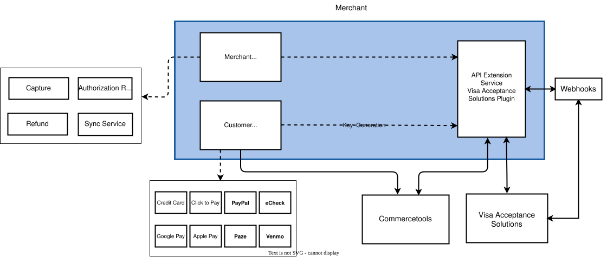

# Commercetools Visa Acceptance Solutions Extension

The Visa Acceptance Solutions extension for Commercetools allows merchants to connect their Commercetools project to Visa Acceptance Solutions for secure payment processing.

- [Supported features](#supported-features)
- [Overview](#overview)
  - [Extension](#Extension)

## Supported features
- Card Payments, Click to Pay, Google Pay, Apple Pay, Paze, PayPal, Venmo, ACH/eCheck
- [Tokenization](./docs/Tokenization.md) to create, update and delete a card token.
- [Refunding](./docs/Refund-a-Payment.md) a payment back to the merchant.
- Authorization [Cancellation](./docs/Reverse-a-Payment.md) on a payment that has not yet been captured.
- [Manual capture](./docs/Capture-a-Payment.md) of a payment.
- [Synchronize payments](./docs/Synchronizing-Payments.md) for synchronizing the missing transactions and fraud transactions based on the decision taken by the merchant.
- [Network Tokens](./docs/Network-Tokens.md) for updating customer token life cycle events through API calls.

## Overview
This repository contains one standalone module that enables the interactaction between a Commercetools project and Visa Acceptance Solutions.
 

1. The front end can be any module which is supported by Commercetools. Refer to [create payment](./docs/Creating-a-Payment.md) to know more about the fields that needs to be passed when a payment is created for each of the payment methods.
2. With help of the [Commercetools HTTP API Extensions](https://docs.commercetools.com/api/projects/api-extensions), provided payment data is sent to the Extension.
3. The Extension authenticates and processes provided payload passed by the front end, exchanges it with Visa Acceptance Solutions APIs and provides **Synchronous** response back to the Commercetools caller. Based on the result, the front end either creates an order or continues with further payment steps. 
Note that order creations or modifications should be part of the front end business logic.

Please see the [Overview](./docs/Overview.md) for a high-level overview of the Extension.

## Extension 

The Extension is a publicly exposed service that acts as a middleware between the Commercetools platform and Visa Acceptance Solutions. Once [Commercetools HTTP API Extensions](https://docs.commercetools.com/api/projects/api-extensions) is [configured](./docs/API-Extension-Setup.md#a-namerunningscriptarunning-extension-setup-script) to call the Visa Acceptance Solutions Extension, payment create or update requests, and customer update requests will be called remotely by your Commercetools project to the Visa Acceptance Platform. 

- Follow [Setup Guide](./docs/Setup.md) for getting started with the integration of Commercetools with the Extension.
- Follow [Usage Guide](./docs/Usage.md) to see more information about the payment services.
