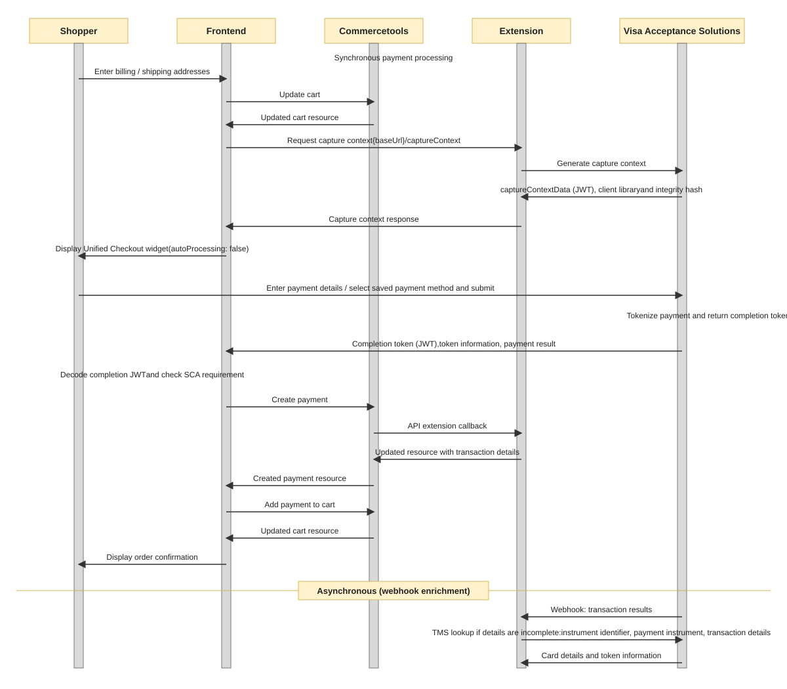

# Unified Checkout payment

This guide describes how to process a payment (PANENTRY,GOOGLEPAY,CLICKTOPAY,APPLEPAY,PAZE,ECHECK,PAYPAL,VENMO) using Visa Acceptance Solutions Unified Checkout (UC). With UC, customers enter payment details directly in the hosted widget, which Visa Acceptance Solutions automatically tokenizes and processes. The UC widget returns a completion token containing the transaction result and card details. This token is submitted to the payment extension, which creates the Commercetools payment resource and can optionally receive webhook notifications containing additional transaction data.

## Unified Checkout payment Sequence Diagram

## Details

1.  Prepare your cart

    a. Ensure your cart locale is set

    b. Ensure the cart billing and shipping addresses are set. The default mapping of Commercetools address fields to Visa Acceptance Solutions fields is as follows

    > **_NOTE:_** : If the cart has multiple shipping methods, the shipping address of the first available shipping method applied to the cart will be used to process the payment

    | Commercetools address       | Visa Acceptance Solutions shipping fields | Visa Acceptance Solutions billing fields | Notes                                                                                                                |
    | --------------------------- | ----------------------------------------- | ---------------------------------------- | -------------------------------------------------------------------------------------------------------------------- |
    | firstName                   | shipTo_firstName                          | billTo_firstName                         |                                                                                                                      |
    | lastName                    | shipTo_lastName                           | billTo_lastName                          |                                                                                                                      |
    | streetNumber and streetName | shipTo_address1                           | billTo_address1                          | If both values populated they are concatenated together with a space between. Otherwise streetName is used by itself |
    | city                        | shipTo_city                               | billTo_city                              |                                                                                                                      |
    | postalCode                  | shipTo_postalCode                         | billTo_postalCode                        |                                                                                                                      |
    | region                      | shipTo_state                              | billTo_state                             |                                                                                                                      |
    | country                     | shipTo_country                            | billTo_country                           |                                                                                                                      |
    | email                       | shipTo_email                              | billTo_email                             |                                                                                                                      |

2.  Capture Context API Call

    Client side calls backend API to generate capture context {baseUrl}/captureContext for the UC widget.

    **Request Parameters:**

    | Parameter                      | Description                           | Required | Notes                                                                                                                                                                                                                                                         |
    | ------------------------------ | ------------------------------------- | -------- | ------------------------------------------------------------------------------------------------------------------------------------------------------------------------------------------------------------------------------------------------------------- |
    | activeCartId                   | Cart ID                               | Yes      | The cart from which to generate the capture context                                                                                                                                                                                                           |
    | multiMidIdentifier             | Multi-MID merchant ID (if applicable) | No       | Specify different merchant ID if using multi-merchant setup                                                                                                                                                                                                   |
    | resolvedCountry                | Country code                          | Yes      | ISO 3166-1 alpha-2 country code                                                                                                                                                                                                                               |
    | resolvedLocale                 | Locale for localization               | Yes      | Locale for UC widget (e.g., en-US, de-DE)                                                                                                                                                                                                                     |
    | resolvedCurrency               | Currency code                         | Yes      | ISO 4217 currency code                                                                                                                                                                                                                                        |
    | isScaRetry                     | SCA retry indicator                   | No       | Set to true if retrying after SCA requirement                                                                                                                                                                                                                 |
    | isSavedCardMode                | Using saved card vs new card          | No       | Set to true when customer selects saved card                                                                                                                                                                                                                  |
    | billTo                         | Billing address object                | Yes      | Billing address; if omitted, cart billing address is used                                                                                                                                                                                                     |
    | paymentInstrumentId            | For saved card, the TMS ID            | No       | Required only when isSavedCardMode is true                                                                                                                                                                                                                    |
    | captureContextCustomFields     | Custom fields configuration           | Yes      | Custom field mappings for the capture context                                                                                                                                                                                                                 |
    | shipTo                         | Shipping address object               | Yes      | Shipping address; if omitted, cart shipping address is used                                                                                                                                                                                                   |
    | clientReferenceCode            | Random unique reference               | Yes      | Unique identifier for this capture context request. PayPal accepts a maximum of 30 characters, so pass the client reference code within that limit.                                                                                                           |
    | isv_metadata                   | Metadata for the order                | Yes      | Additional custom data sent with the authorization request                                                                                                                                                                                                    |
    | isv_ucAllowedPaymentTypes      | Allowed payment types                 | Yes      | Comma-separated payment types (PANENTRY,GOOGLEPAY,CLICKTOPAY,APPLEPAY,PAZE,ECHECK,PAYPAL,VENMO) available in Unified Checkout. For Express Pay or minicart flows, pass (GOOGLEPAY, PAYPAL, VENMO, APPLEPAY, and PAZE). For saved-card flows pass (TMS_TOKEN). |
    | isv_ucBillingType              | Billing type                          | Yes      | Billing type configuration for Unified Checkout                                                                                                                                                                                                               |
    | isv_ucShowAcceptedNetworkIcons | Show accepted network icons           | Yes      | Set to true to display accepted card network icons                                                                                                                                                                                                            |
    | isv_ucTargetOrigins            | Unified Checkout target origins       | Yes      | Allowed origin or origins for Unified Checkout                                                                                                                                                                                                                |
    | isv_enabledMoto | Flag Indicating MOTO transaction | No      | Boolean value. Used by the extention to identify whether it is a normal transaction or MOTO transaction |

    **Response Contains:**
    - `captureContextData` - JWT for UC widget initialization
    - `clientLibrary` - URL to Visa Acceptance Solutions UC JavaScript library
    - `clientLibraryIntegrity` - Integrity hash for the library
    - `captureContextClientRefCode` - Client reference code

      > **_NOTE:_** MOTO transactions are controlled server-side via the `PAYMENT_GATEWAY_ENABLE_MOTO` environment variable. Set this to `true` in your deployment configuration to enable MOTO processing.

    check (UnifiedCheckout-setup.md) for more details about how to handle UC.

3.  Customer Completes Payment in Widget

4.  Client side Receives Completion Token

    Decode and Check for
    - SCA/authentication status (it is used for SCA retry transaction) and the payment solution id is used to find the payment method
    - If isScaRetry = true is returned, retry the transaction by requesting a new capture context and reinitiating the payment.
    - Refer [UnifiedCheckout-Setup#Decoding transient token](UnifiedCheckout-Setup.md#decoding-transient-token) for details on decoding the transient token

5.  Create a Commercetools payment (https://docs.commercetools.com/api/projects/payments) and populate the fields

    Populate the following fields to create a payment:

    | Property                               | Value                                                                | Required | Notes                                                                                                                                                                                                                                                                                                                                                                                                          |
    | -------------------------------------- | -------------------------------------------------------------------- | -------- | -------------------------------------------------------------------------------------------------------------------------------------------------------------------------------------------------------------------------------------------------------------------------------------------------------------------------------------------------------------------------------------------------------------- |
    | custom.fields.isv_transientToken       | Visa Acceptance Solutions transient token (completion token)         | Yes      | Can be obtained from the token parameter passed into the callback for the unified checkout invoke call.                                                                                                                                                                                                                                                                                                        |
    | paymentMethodInfo.method               | Payment method used                                                  | Yes      | Refer [UnifiedCheckout-Setup\#Decoding transient token](UnifiedCheckout-Setup.md#Decoding-transient-token) to get the value for this field                                                                                                                                                                                                                                                                     |
    | amountPlanned                          | Amount to be processed                                               | Yes      | Should match cart gross total, unless split payments are being used                                                                                                                                                                                                                                                                                                                                            |
    | paymentMethodInfo.paymentInterface     | Visa Acceptance Solutions                                            | Yes      |                                                                                                                                                                                                                                                                                                                                                                                                                |
    | custom.fields.isv_customerIpAddress    | Customer IP address                                                  | No       | Populated from client-side libraries                                                                                                                                                                                                                                                                                                                                                                           |
    | custom.fields.isv_shippingMethod       | Shipping method for the order                                        | No       | Possible values: <ul> <li> `lowcost`: Lowest-cost service </li> <li>`sameday`: Courier or same-day service </li> <li>`oneday`: Next-day or overnight service </li> <li>`twoday`: Two-day service </li> <li>`threeday`: Three-day service.</li> <li> `pickup`: Store pick-up </li> <li> `other`: Other shipping method </li> <li> `none`: No shipping method because product is a service or subscription </li> |
    | custom.fields.isv_metadata             | Metadata for the order                                               | No       | This field can be used to send additional custom data as part of the authorization request. The data should be serialized into a string format (e.g., JSON string) before passing it in the request. **Example:**"isv_metadata": "{\"1\":\"value1\", \"2\":\"value2\"}"                                                                                                                                     |
    | custom.fields.isv_accountPurchaseCount | Required to determine account creation history and purchase activity | No       | Provide the user's purchase count for the last six months. This value will be used to determine account creation history and populate the riskInformation section of the authorization request                                                                                                                                                                                                                 |

    If a saved card is used then we need to send these values as well

    | Property                          | Value              | Required | Notes                                                                                                                                                                                                                                                                                                                            |
    | --------------------------------- | ------------------ | -------- | -------------------------------------------------------------------------------------------------------------------------------------------------------------------------------------------------------------------------------------------------------------------------------------------------------------------------------- |
    | custom.fields.isv_maskedPan       | Masked Card number | No       | Can be obtained from the token parameter passed into the callback for the unified checkout invoke call. The token is a JWT which when decoded has a `unifiedCheckoutData.content.paymentInformation.card.number.maskedValue` field containing the masked card number    Not required by the extension but used for display |
    | custom.fields.isv_cardType        | Card type          | No       | Can be obtained from the token parameter passed into the callback for the unified checkout invoke call. The token is a JWT which when decoded has a `unifiedCheckoutData.content.paymentInformation.card.number.detectedCardTypes[0]` field containing the card type    Not required by the extension but used for display |
    | custom.fields.isv_cardExpiryMonth | Card expiry month  | No       | Can be obtained from the token parameter passed into the callback for the unified checkout invoke call. The token is a JWT which when decoded has a `unifiedCheckoutData.content.paymentInformation.card.expirationMonth.value` field containing the card type    Not required by the extension but used for display       |
    | custom.fields.isv_cardExpiryYear  | Card expiry year   | No       | Can be obtained from the token parameter passed into the callback for the unified checkout invoke call. The token is a JWT which when decoded has a `unifiedCheckoutData.content.paymentInformation.card.expirationYear.value` field containing the card type    Not required by the extension but used for display        |

    If a saved eCheck account is used then we need to send these values as well

    | Property                        | Value                 | Required | Notes                                                                                                  |
    | ------------------------------- | --------------------- | -------- | ------------------------------------------------------------------------------------------------------ |
    | custom.fields.isv_accountNumber | Masked account number | No       | Obtained from the `accountNumber` value of the saved eCheck token in the customer's `isv_tokens` field |
    | custom.fields.isv_routingNumber | Masked routing number | No       | Obtained from the `routingNumber` value of the saved eCheck token in the customer's `isv_tokens` field |
    | custom.fields.isv_accountType   | Account type          | No       | Obtained from the `accountType` value of the saved eCheck token in the customer's `isv_tokens` field   |

6.  Verify the payment state and convey the payment result to the customer

    a. If the transaction is successful, transaction state will be **Success**, display the order confirmation page

    b. If the state of transaction is **Pending** which is due to Fraud, display the order confirmation page

    c. If the state of transaction is updated to **Failure**, display the error page and See [Overview\#Errorhandling](Overview.md#error-handling) for handling errors or failures

7.  Add Payment to Cart

    Associates the newly created payment with the commercetools cart by updating the cart's payment reference. This links the payment transaction to the order.

8.  Create Order

    Create the commercetools order from the cart now that the payment has been added. Once the order is created, display the order confirmation page to the customer.

9.  Backend Receives Webhook Notification

    While customer sees order confirmation, Visa Acceptance Solutions sends webhook with transaction results.

> **Note:** Payment and transaction synchronisation is handled through Webhooks and alternatively [Decision Sync](Synchronizing-Payments.md#Implementation). Refer to [Webhooks](Webhooks.md) for more details.

## Transaction Outcomes

| Status                               | Meaning                               | Payment Status | Next Action             |
| ------------------------------------ | ------------------------------------- | -------------- | ----------------------- |
| **AUTHORIZED**                       | Auth successful (auth-only mode)      | Success        | Can capture later       |
| **AUTHORIZED_PENDING_REVIEW**        | Fraud under review (Decision Manager) | Pending        | Wait for review         |
| **DECLINED**                         | Transaction declined                  | Failure        | Show error to customer  |
| **CUSTOMER_AUTHENTICATION_REQUIRED** | SCA challenge needed                  | Error          | Retry checkout with SCA |
